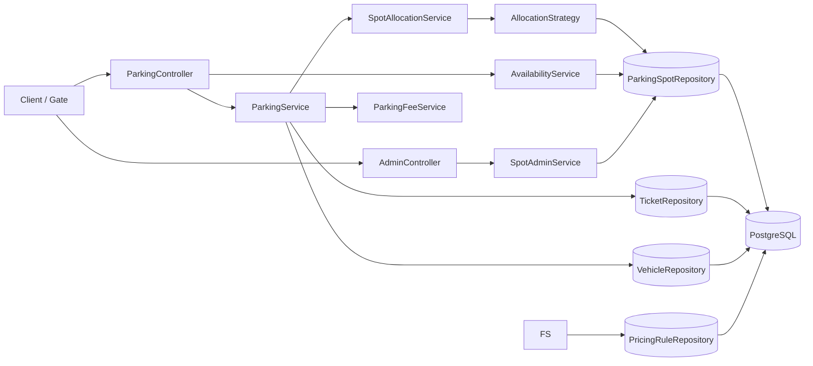
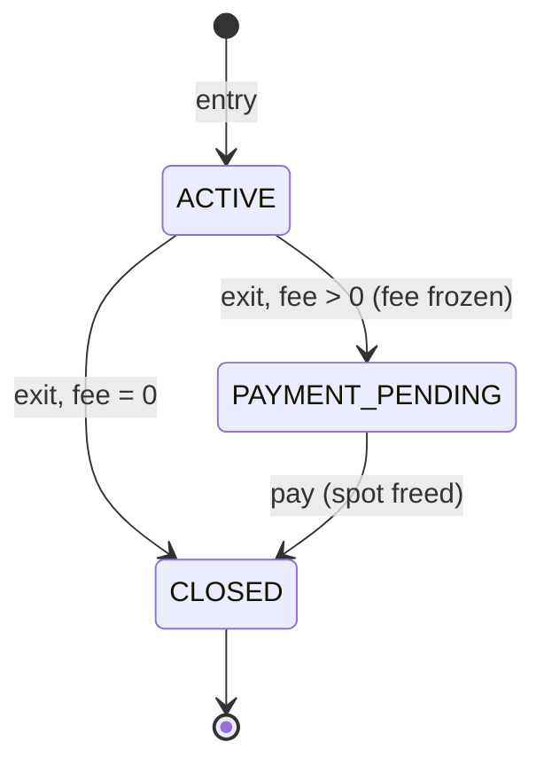
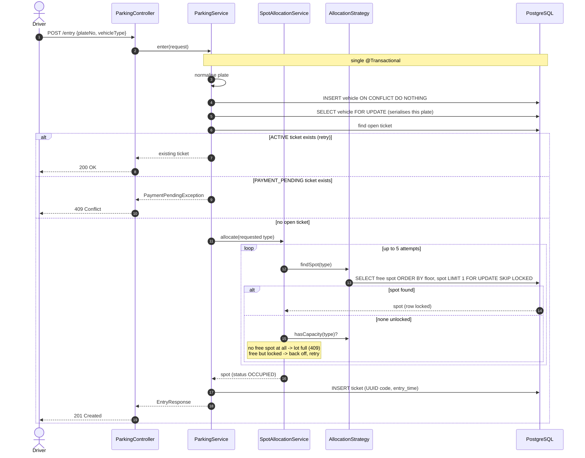
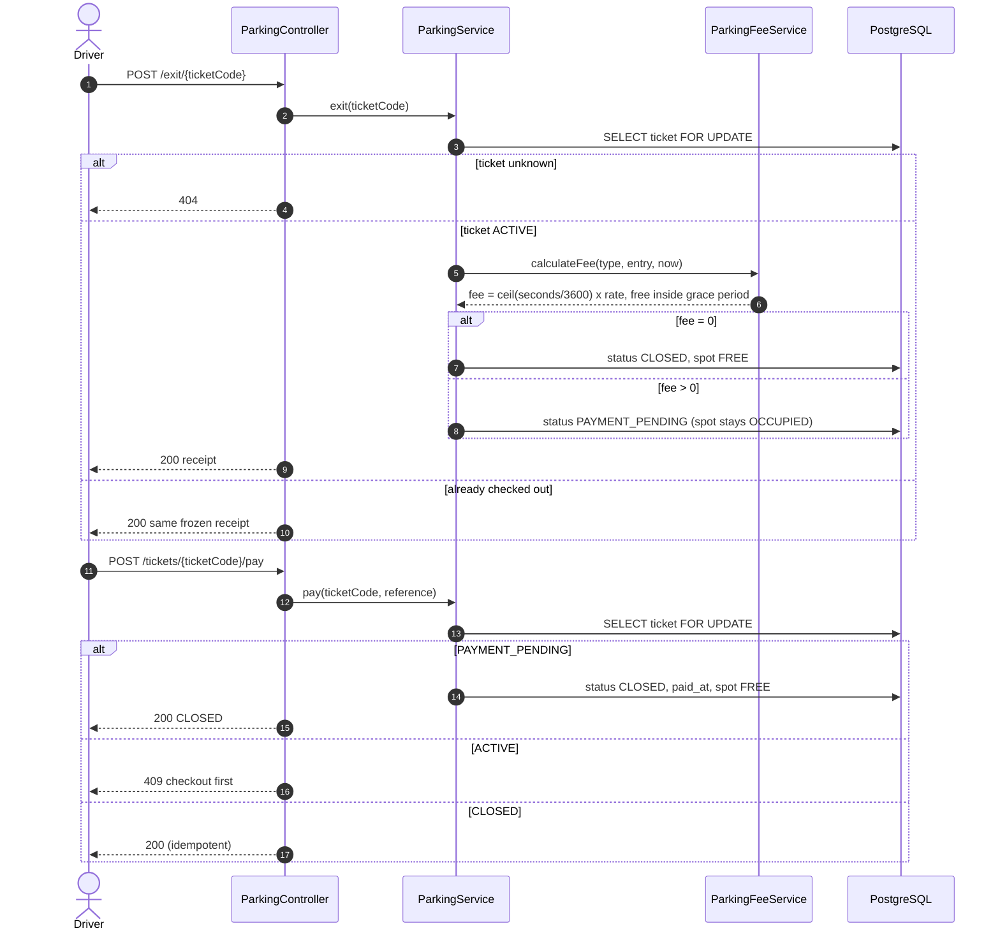

# Smart Parking Lot (Spring Boot)

Backend for a multi-floor parking lot: spot allocation by vehicle size, check-in/check-out,
fee calculation with a payment step, and live availability.

## Run
1. Start Postgres with a database named `SmartParkingLotSystem` (see `application.properties`).
2. `./gradlew bootRun` (tables, the one-open-ticket index and seed data are created automatically).

Build a jar with `./gradlew build`. The Gradle wrapper is not bundled; generate it once with `gradle wrapper` (or use your installed Gradle).

Seed data: 3 floors (2 motorcycle, 6 car, 2 bus spots each); rates MOTORCYCLE 10, CAR 30, BUS 80 per hour, 15 free minutes.

## API
| Method | Path | Purpose                                                                                                    |
|---|---|------------------------------------------------------------------------------------------------------------|
| POST | `/api/v1/parking/entry` | `{"plateNo":"TS09AB1234","vehicleType":"CAR"}` -> 201 new ticket, 200 if already parked (idempotent retry) |
| POST | `/api/v1/parking/exit/{ticketCode}` | checkout: freezes the fee; zero fee closes at once, otherwise `PAYMENT_PENDING`                            |
| POST | `/api/v1/parking/exit/by-plate` | lost-ticket checkout (staff)                                                                               |
| POST | `/api/v1/parking/tickets/{ticketCode}/pay` | `{"paymentReference":"..."}` closes the ticket and frees the spot                                          |
| GET | `/api/v1/parking/availability` | free spots per floor and spot type, plus totals                                                            |
| POST | `/api/v1/admin/spots` | add spots to a floor `{"floorNumber":2,"spotType":"BUS","count":2}` (staff)                                |
| PATCH | `/api/v1/admin/spots/{id}/status` | `FREE` / `RESERVED` / `OUT_OF_SERVICE` (staff)                                                             |

Errors use RFC 7807 problem details: 400 validation, 404 unknown ticket/spot, 409 lot full / state conflict / payment pending, 503 (+ `Retry-After`) when free spots are momentarily locked.

## Architecture
Layered monolith: `controller` -> `service` -> `repository` (Spring Data JPA / PostgreSQL).
Allocation is behind `AllocationStrategy`; rates live in the `pricing_rule` table.

### Ticket lifecycle

A vehicle can hold only one ACTIVE or PAYMENT_PENDING ticket (enforced by a row lock and a unique partial index).

Data model: `Ticket` owns the foreign keys (`@ManyToOne` to `Vehicle` and `ParkingSpot`); `Vehicle.tickets` and `ParkingSpot.tickets` are the inverse `@OneToMany(mappedBy = ...)` sides, each with an `addTicket` helper that keeps both sides in sync. There is no cascade, so tickets are never deleted implicitly.

## Sequence diagrams

### Vehicle entry

### Checkout and payment

## Edge cases handled
| Area | Behaviour |
|---|---|
| Plate identity | trimmed, upper-cased, spaces/hyphens removed (`ts09-ab 1234` == `TS09AB1234`) |
| Returning vehicle, new type | the type in the current request decides the spot |
| Retried entry | returns the existing ticket (200) instead of failing |
| Concurrent entries, same plate | serialised by a vehicle row lock; one ticket |
| Concurrent entries, same spot | `FOR UPDATE SKIP LOCKED`; false "full" avoided by capacity check + back-off |
| Fee boundaries | second precision: 15:00 free, 15:01 = 1h, 60:00 = 1h, 60:01 = 2h; clock skew = free |
| Missing rate card | app refuses to start |
| Repeated exit / pay | idempotent, fee frozen at first checkout |
| Unpaid vehicle re-entering | 409 until payment settled |
| Out-of-service / reserved spots | never allocated, not counted as free |
| Ticket codes | random UUIDs; numeric ids never exposed |
| Errors | no SQL or stack details in responses; unknown/invalid input maps to 4xx |

## Known limitations
- Buses use a single BUS spot. Multi-spot buses plug in as another `AllocationStrategy` (lock N adjacent spots in a fixed order to avoid deadlocks).
- `/admin/**` and `/exit/by-plate` have no authentication; put them behind staff authorisation before real use.
- No payment gateway: `pay` records a reference supplied by the caller.
- Availability is computed with a query; add Redis counters if read load demands it.

## Tests

Layered test suite, one slice per component. Two Gradle tasks keep the feedback loop fast:

| Command | What runs | Docker |
|---|---|---|
| `./gradlew test` | controller, service, strategy, config, util and entity tests | not needed |
| `./gradlew dockerTest` | repository and integration tests (tagged `docker`, real Postgres via Testcontainers) | required |
| `./gradlew allTests` | everything above | required |

| Layer | Test class (package under `src/test/java/com/parking`) | Style |
|---|---|---|
| Controller | `controller/ParkingControllerTest`, `controller/AdminControllerTest` | `@WebMvcTest` + `MockMvc`, services mocked: routing, JSON mapping, validation, status codes (400/404/405/409/500/503), no SQL leakage |
| Service | `service/ParkingServiceTest`, `SpotAllocationServiceTest`, `AvailabilityServiceTest`, `SpotAdminServiceTest`, `FeeServiceTest` | Mockito, no Spring: entry/exit/pay flows, retries and back-off, aggregation, fee boundaries, fixed `Clock` |
| Strategy | `strategy/NearestSpotAllocationStrategyTest` | Mockito: preference order, motorcycle fallback, bus never falls back, capacity check |
| Repository | `repository/ParkingSpotRepositoryTest`, `VehicleRepositoryTest`, `TicketRepositoryTest` | `@DataJpaTest` on real Postgres: ordering, `SKIP LOCKED` query, upsert, locking queries, unique and partial-unique constraints |
| Config / util | `config/PricingConfigValidatorTest`, `util/PlateNumbersTest` | plain JUnit / Mockito |
| Integration | `integration/ParkingFlowTest`, `ParkingConcurrencyTest`, `ParkingApiTest` | `@SpringBootTest` on real Postgres: end-to-end flows, 50-thread races, HTTP behaviour |

Repository and integration tests share one Postgres container (`support/SharedPostgres`). They use Postgres on purpose: `SKIP LOCKED`, `ON CONFLICT` and partial indexes behave differently on H2.

Conventions: test names read as behaviour (`exit_secondCall_returnsTheSameReceipt_withoutRecalculating`), time comes from an injected `Clock` (`MutableClock` in integration tests), and controller tests never touch a database.
